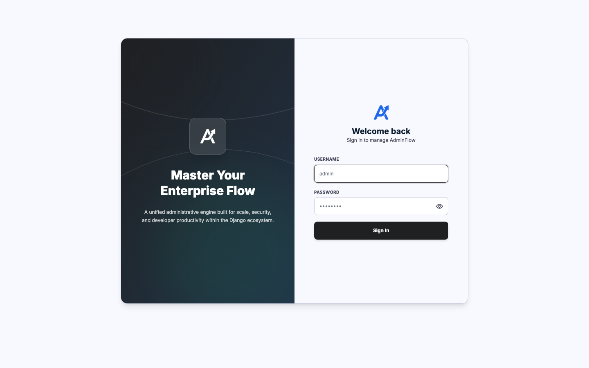
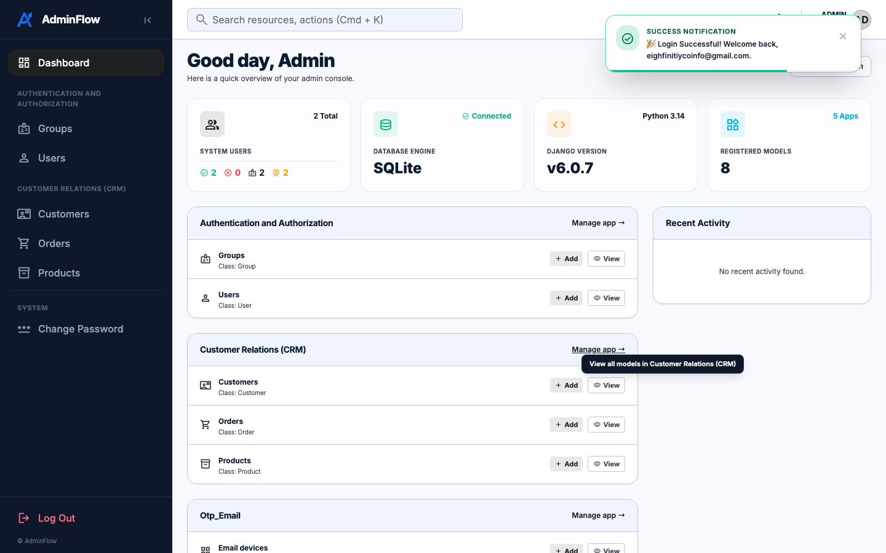
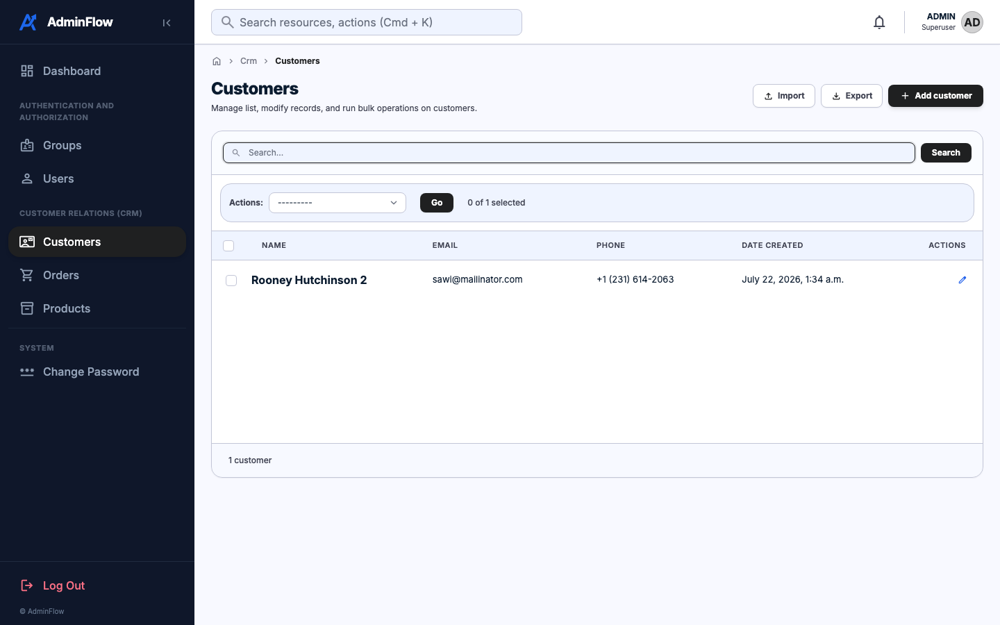
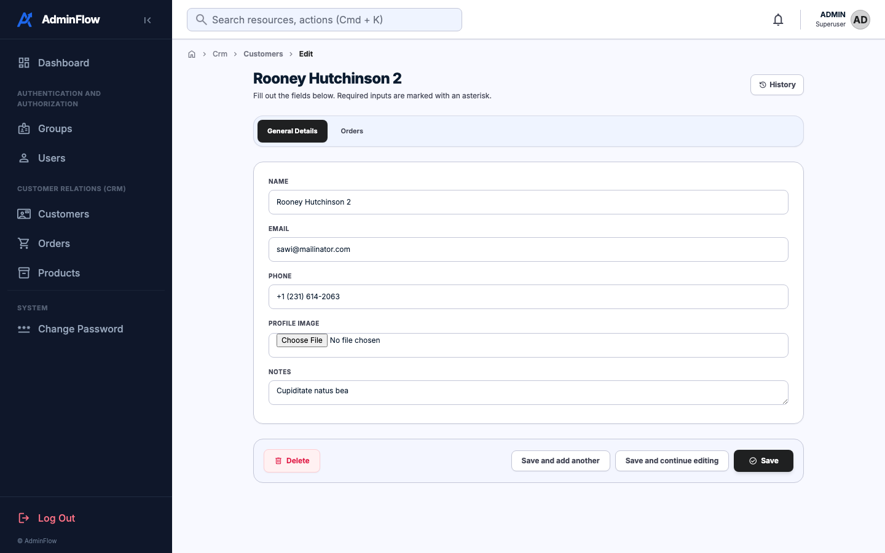
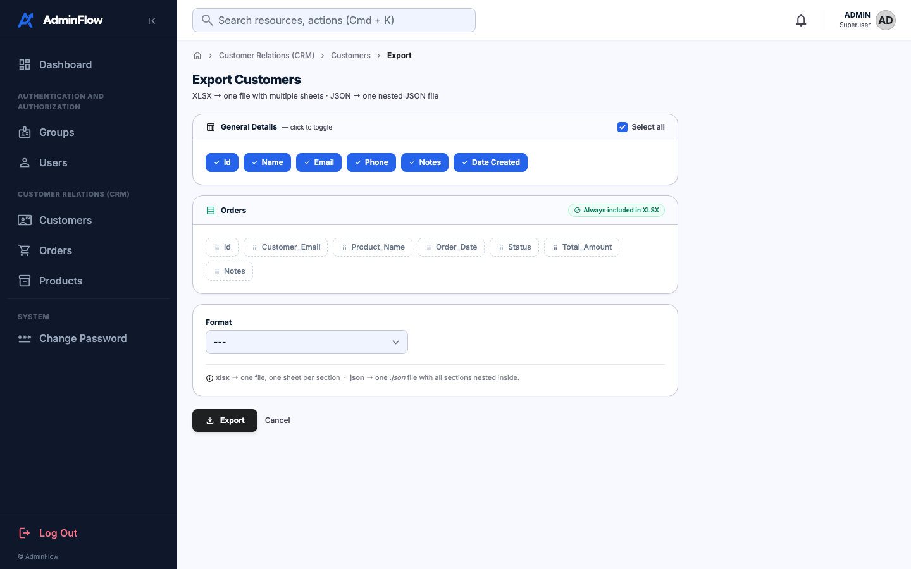
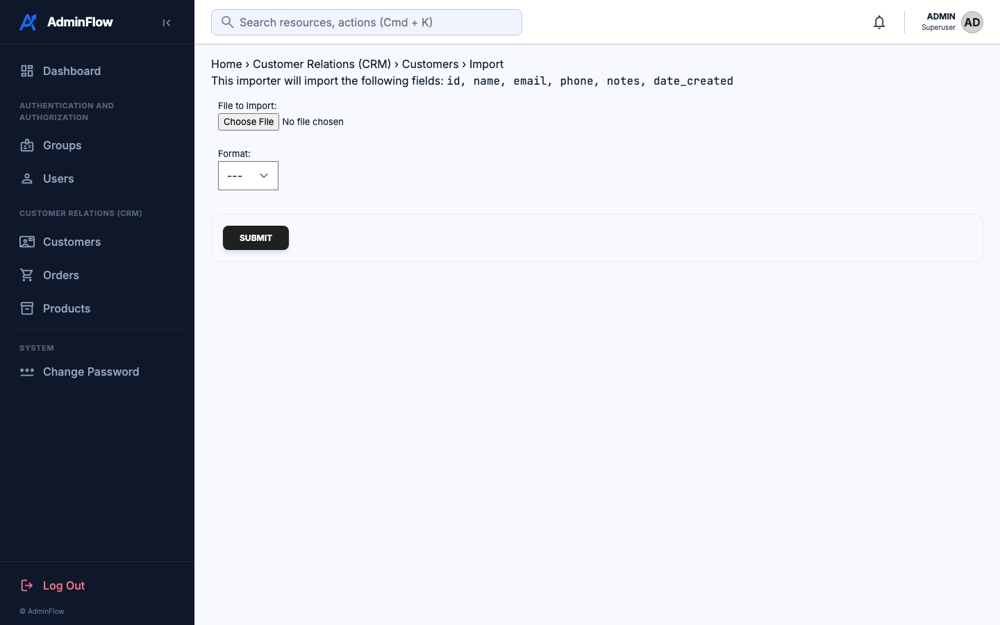
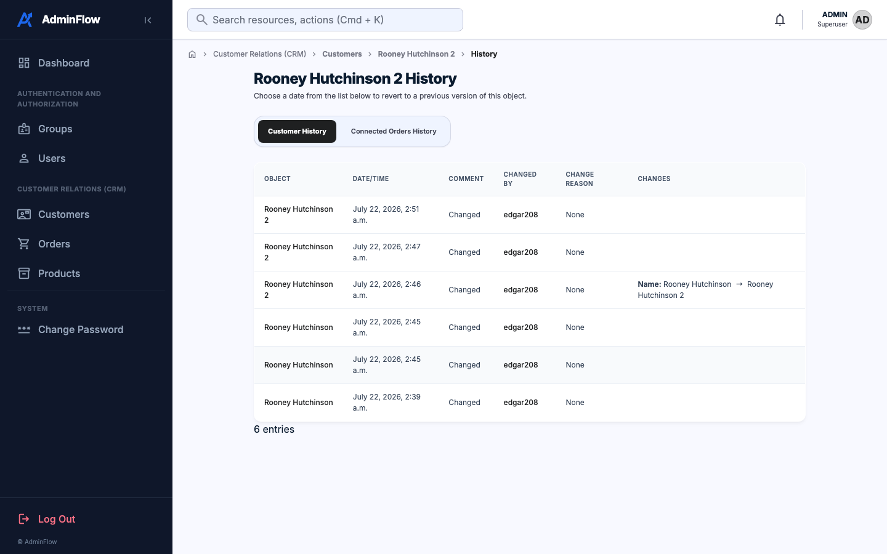
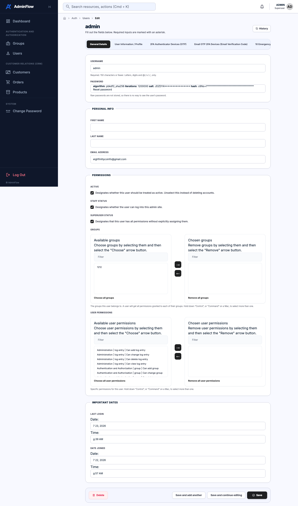

# django-adminflow

**A modern Django Admin UI template with built-in integrations for popular 3rd party packages.**

[](https://pypi.org/project/django-adminflow/)
[](https://pypi.org/project/django-adminflow/)
[](https://pypi.org/project/django-adminflow/)
[](LICENSE)

AdminFlow is a **drop-in Django Admin UI template** that replaces the default Django admin with a clean, minimalist SaaS-grade interface. Beyond the UI refresh, it ships with **ready-to-use integrations** for the most popular Django ecosystem packages — two-factor authentication, per-record audit history, and multi-format import/export — so you get powerful admin features with zero boilerplate.

> **One package. Install it, add it to `INSTALLED_APPS`, and your admin instantly looks and works like a premium SaaS product.**

---

## What is AdminFlow?

The default Django admin is functional but dated. AdminFlow wraps it with:

- A **modern, minimalist UI** built with Tailwind utility classes and Material Symbols icons
- A **collapsible sidebar** with app grouping, icons per model, and active state tracking
- **Responsive layouts** — works on tablet and desktop
- **Clean typography** using Inter font (loaded from Google Fonts)
- **Integrated 3rd party packages** — install the extras you need, and the UI for them is already there

AdminFlow is **not** a full CMS replacement. It is a **UI skin + integration layer** for the Django admin you already use.

---

## Screenshots

### Login


### Dashboard


### Model List (Changelist) — with Import & Export buttons


### Model Detail (Change Form)


### Export Page — multi-sheet, selectable fields


### Import Page


### Audit History — field-level diff


### Users & 2FA Management


---

## Features

| Feature | Description |
|---|---|
| 🎨 **Modern UI** | Minimalist SaaS design — clean typography, sidebar, responsive layout |
| 🔒 **Two-Factor Auth** | TOTP (Google/Authy), email OTP, backup codes — multi-device support |
| 📜 **Audit History** | Per-record change history with field-level diffs |
| 📤 **Import / Export** | Multi-sheet XLSX + nested JSON export with related models in one file |
| 🔌 **Plug & Play** | Add to `INSTALLED_APPS` — no additional config required for core UI |
| 🌐 **i18n Ready** | All UI strings use `` |

---

## Installation

### Core UI only
```bash
pip install django-adminflow
```

### With 2FA (django-otp)
```bash
pip install "django-adminflow[otp]"
```

### With audit history (django-simple-history)
```bash
pip install "django-adminflow[history]"
```

### With import / export (django-import-export)
```bash
pip install "django-adminflow[import-export]"
```

### Everything
```bash
pip install "django-adminflow[all]"
```

---

## Quick Setup

### `settings.py`

```python
INSTALLED_APPS = [
    "adminflow",                            # ← BEFORE django.contrib.admin
    "django.contrib.admin",
    "django.contrib.auth",
    "django.contrib.contenttypes",
    "django.contrib.sessions",
    "django.contrib.messages",
    "django.contrib.staticfiles",

    # Add only what you installed:
    "simple_history",                       # audit history
    "import_export",                        # import/export
    "django_otp",                           # 2FA core
    "django_otp.plugins.otp_totp",          # TOTP authenticator app
    "django_otp.plugins.otp_email",         # email OTP
    "django_otp.plugins.otp_static",        # backup codes
]

ADMINFLOW_TITLE = "My App"                  # optional: customize admin title

MIDDLEWARE = [
    "django.middleware.security.SecurityMiddleware",
    "django.contrib.sessions.middleware.SessionMiddleware",
    "django.middleware.common.CommonMiddleware",
    "django.middleware.csrf.CsrfViewMiddleware",
    "django.contrib.auth.middleware.AuthenticationMiddleware",
    "django_otp.middleware.OTPMiddleware",              # ← add for 2FA
    "django.contrib.messages.middleware.MessageMiddleware",
    "simple_history.middleware.HistoryRequestMiddleware",  # ← add for history
]
```

That's it for the core UI. No template overrides, no extra URLs needed.

---

## 3rd Party Integrations

### 🔒 Two-Factor Authentication — `django-otp`

AdminFlow wraps `django-otp` with a polished UI: OTP verification on login, per-device management in the user admin, and admin bulk actions.

**What you get:**
- Styled OTP verification page (TOTP / email / backup codes)
- "Security" tab in the user change form with device list
- Admin actions: *Enable 2FA*, *Generate 10 backup codes*
- Support for multiple devices per user

**Setup:**

```python
# admin.py
from django.contrib import admin
from django.contrib.auth import get_user_model
from django.contrib.auth.admin import UserAdmin as BaseUserAdmin
from adminflow.user_admin import AdminFlowUserAdminMixin, get_2fa_inlines, unregister_otp_models

User = get_user_model()

@admin.register(User)
class UserAdmin(AdminFlowUserAdminMixin, BaseUserAdmin):
    inlines = get_2fa_inlines()

unregister_otp_models()   # remove the default django-otp admin entries
```

---

### 📜 Audit History — `django-simple-history`

Track every change to every record with field-level diffs shown in a clean timeline.

**Setup:**

```python
# models.py
from simple_history.models import HistoricalRecords

class Product(models.Model):
    name  = models.CharField(max_length=200)
    price = models.DecimalField(max_digits=10, decimal_places=2)
    history = HistoricalRecords()

# admin.py
from simple_history.admin import SimpleHistoryAdmin

@admin.register(Product)
class ProductAdmin(SimpleHistoryAdmin):
    list_display = ('name', 'price')
```

---

### 📤 Import / Export — `django-import-export`

Export multiple related models into **one XLSX file** (multi-sheet) or **one nested JSON file**. Import from multi-sheet XLSX in one step.

**Export formats:**

| Format | Output |
|---|---|
| **xlsx** | One `.xlsx` file with one sheet per resource |
| **json** | One `.json` file with child records nested inside parent records |

**Setup:**

```python
# resources.py
from import_export import resources, fields
from import_export.widgets import ForeignKeyWidget
from .models import Customer, Order

class CustomerResource(resources.ModelResource):
    class Meta:
        model  = Customer
        fields = ('id', 'name', 'email', 'phone', 'notes', 'date_created')

class OrderResource(resources.ModelResource):
    customer = fields.Field(
        column_name='customer_email',
        attribute='customer',
        widget=ForeignKeyWidget(Customer, field='email'),
    )
    class Meta:
        model  = Order
        fields = ('id', 'customer', 'product', 'order_date', 'status', 'total_amount')

# admin.py
from adminflow.import_export import MultiSheetExportImportMixin
from import_export.admin import ImportExportModelAdmin

@admin.register(Customer)
class CustomerAdmin(MultiSheetExportImportMixin, ImportExportModelAdmin, admin.ModelAdmin):
    combined_sheets = [
        ('General Details', CustomerResource, None),
        ('Orders', OrderResource, lambda qs: Order.objects.filter(customer__in=qs)),
    ]
```

**JSON output:**

```json
[
  {
    "id": "1",
    "name": "Alice Johnson",
    "email": "alice@example.com",
    "orders": [
      { "id": "1", "customer_email": "alice@example.com", "order_date": "2026-07-22", "status": "delivered" }
    ]
  }
]
```

---

## Customisation

```python
# settings.py
ADMINFLOW_TITLE = "My SaaS App"
```

```python
# admin.py — set a Material Symbols icon per model
@admin.register(Product)
class ProductAdmin(admin.ModelAdmin):
    icon = "inventory_2"
```

---

## Changelog

### v1.0.0 — 2026-07-23
- Initial stable release
- Modern minimalist admin UI (sidebar, Inter font, responsive)
- Full 2FA: TOTP, email OTP, backup codes, multi-device
- Audit history with field-level diffs (django-simple-history)
- Multi-sheet XLSX export/import (one sheet per related model)
- Nested JSON export (children embedded inside parent records)
- `MultiSheetExportImportMixin` for plug-and-play multi-resource export
- Styled Import / Export buttons and export/import pages

---

## Publishing

```bash
pip install build twine
python -m build
twine upload dist/*
```

## License

MIT
