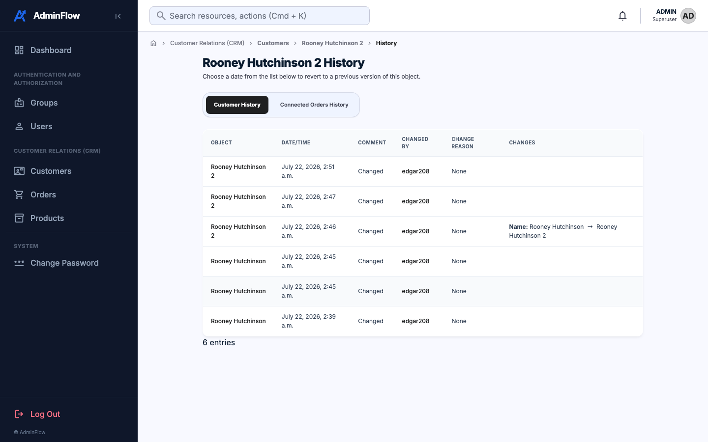

Audit History
=============

AdminFlow integrates with `django-simple-history <https://django-simple-history.readthedocs.io/>`_
to give every model a full per-record change log — who changed what, when, with
field-level before/after diffs rendered in a clean timeline.

----

Requirements
------------

.. code-block:: bash

   pip install "django-adminflow[history]"

Add to ``INSTALLED_APPS`` and ``MIDDLEWARE``:

.. code-block:: python

   INSTALLED_APPS = [
       "adminflow",
       "django.contrib.admin",
       ...
       "simple_history",    # ← add this
   ]

   MIDDLEWARE = [
       ...
       "django.contrib.auth.middleware.AuthenticationMiddleware",
       "simple_history.middleware.HistoryRequestMiddleware",  # ← add this (records who made the change)
       ...
   ]

Run migrations:

.. code-block:: bash

   python manage.py migrate

----

Adding History to a Model
--------------------------

Add ``HistoricalRecords`` to any model:

.. code-block:: python

   # models.py
   from django.db import models
   from simple_history.models import HistoricalRecords

   class Customer(models.Model):
       name         = models.CharField(max_length=200)
       email        = models.EmailField(unique=True)
       phone        = models.CharField(max_length=50, blank=True)
       notes        = models.TextField(blank=True)
       date_created = models.DateTimeField(auto_now_add=True)

       history = HistoricalRecords()   # ← this is all you need

       def __str__(self):
           return self.name

----

Enabling the History Admin
--------------------------

Use ``SimpleHistoryAdmin`` as your admin base class:

.. code-block:: python

   # admin.py
   from django.contrib import admin
   from simple_history.admin import SimpleHistoryAdmin
   from .models import Customer

   @admin.register(Customer)
   class CustomerAdmin(SimpleHistoryAdmin):
       list_display = ('name', 'email', 'phone', 'date_created')

AdminFlow automatically styles the history list and diff view — no extra code needed.

----

History View
------------

Every change form gets a **History** button in the top-right. Clicking it shows:

Each entry shows:

* **Timestamp** — date and time of the change
* **Changed by** — the staff user who made the change
* **Field diffs** — old value (strikethrough red) → new value (green)
* **Change type** — Created / Changed / Deleted badge

----

Querying History
----------------

Access history programmatically:

.. code-block:: python

   customer = Customer.objects.get(pk=1)

   # All history records for this customer
   for record in customer.history.all():
       print(record.history_date, record.history_user, record.history_type)

   # Get the previous version
   previous = customer.history.first().prev_record

   # See what changed between two versions
   delta = customer.history.first().diff_against(previous)
   for change in delta.changes:
       print(f"{change.field}: {change.old!r} → {change.new!r}")

----

Excluding Fields from History
------------------------------

.. code-block:: python

   class Customer(models.Model):
       name     = models.CharField(max_length=200)
       password = models.CharField(max_length=128)  # don't track this

       history = HistoricalRecords(excluded_fields=["password"])
