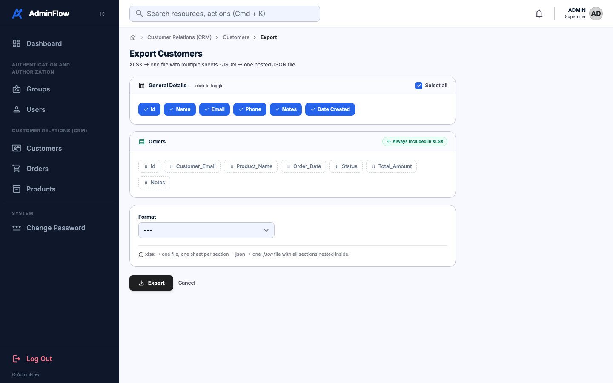
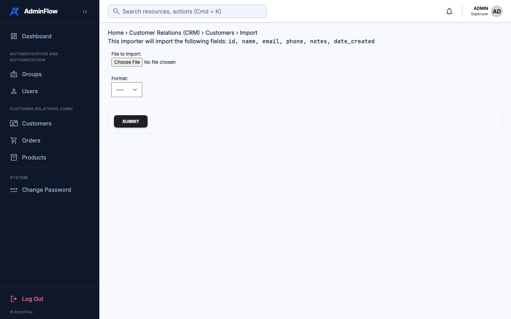

Import / Export
===============

AdminFlow extends `django-import-export <https://django-import-export.readthedocs.io/>`_ with
``MultiSheetExportImportMixin`` — a mixin that lets you export multiple related models into
**one XLSX file** (each model on its own sheet) or **one nested JSON file**
(child records embedded inside their parent).

----

Requirements
------------

.. code-block:: bash

   pip install "django-adminflow[import-export]"

Add ``import_export`` to ``INSTALLED_APPS``:

.. code-block:: python

   INSTALLED_APPS = [
       "adminflow",
       "django.contrib.admin",
       ...
       "import_export",    # ← add this
   ]

----

Export Formats
--------------

.. list-table::
   :header-rows: 1
   :widths: 15 85

   * - Format
     - Output
   * - **xlsx**
     - One ``.xlsx`` file — one worksheet per resource (requires ``openpyxl``)
   * - **json**
     - One ``.json`` file — child records nested inside each parent record

----

Setting Up Resources
--------------------

Define resources using ``django-import-export``'s standard ``ModelResource`` class:

.. code-block:: python

   # resources.py
   from import_export import resources, fields
   from import_export.widgets import ForeignKeyWidget
   from .models import Customer, Order

   class CustomerResource(resources.ModelResource):
       class Meta:
           model  = Customer
           fields = ('id', 'name', 'email', 'phone', 'notes', 'date_created')
           export_order = ('id', 'name', 'email', 'phone', 'notes', 'date_created')

   class OrderResource(resources.ModelResource):
       # Use email as the FK reference field so the exported file is human-readable
       customer = fields.Field(
           column_name='customer_email',
           attribute='customer',
           widget=ForeignKeyWidget(Customer, field='email'),
       )

       class Meta:
           model  = Order
           fields = ('id', 'customer', 'product', 'order_date', 'status', 'total_amount')

----

Enabling Multi-Sheet Export
----------------------------

Use ``MultiSheetExportImportMixin`` in your admin class:

.. code-block:: python

   # admin.py
   from django.contrib import admin
   from import_export.admin import ImportExportModelAdmin
   from adminflow.import_export import MultiSheetExportImportMixin
   from .models import Customer, Order
   from .resources import CustomerResource, OrderResource

   @admin.register(Customer)
   class CustomerAdmin(MultiSheetExportImportMixin, ImportExportModelAdmin, admin.ModelAdmin):

       # combined_sheets drives both export layout and import sheet-matching
       combined_sheets = [
           # (sheet_title,      ResourceClass,    queryset_lambda_or_None)
           ('General Details',  CustomerResource, None),
           ('Orders',           OrderResource,    lambda qs: Order.objects.filter(customer__in=qs)),
       ]

       list_display = ('name', 'email', 'phone', 'date_created')

``combined_sheets`` format:

.. code-block:: text

   (sheet_title, ResourceClass, queryset_lambda_or_None)

* ``sheet_title``  — used as the Excel sheet name and the JSON section key.
* ``ResourceClass``  — a ``ModelResource`` that controls which fields to include.
* ``queryset_lambda`` — receives the **parent** queryset and returns the related child queryset.
  Pass ``None`` for the primary (parent) resource.

----

The Export Page
---------------

The export page has two sections:

**Primary fields** (checkboxes)
   Fields from the first entry in ``combined_sheets``. Check or uncheck to control which
   columns appear in the export.

**Sub-sheet fields** (read-only chips)
   Fields from all remaining entries — always included automatically.

**Format selector**
   Choose ``xlsx`` (multi-sheet) or ``json`` (nested).

----

XLSX Output
-----------

Selecting **xlsx** produces a single ``.xlsx`` file where each entry in
``combined_sheets`` becomes a separate worksheet:

.. code-block:: text

   customer_export.xlsx
   ├── Sheet: General Details   (Customer fields)
   └── Sheet: Orders            (Order fields)

----

JSON Output
-----------

Selecting **json** produces a single ``.json`` file with child records nested
inside their parent:

.. code-block:: json

   [
     {
       "id": "1",
       "name": "Alice Johnson",
       "email": "alice@example.com",
       "phone": "+1 (555) 123-4567",
       "notes": "",
       "date_created": "2026-07-22 01:34:49",
       "orders": [
         {
           "id": "1",
           "customer_email": "alice@example.com",
           "product": "Mona Kelly",
           "order_date": "2026-07-22",
           "status": "delivered",
           "total_amount": "42222.00"
         }
       ]
     }
   ]

The nest key is the sub-sheet title lowercased with spaces replaced by underscores
(``"Orders"`` → ``"orders"``).

----

The Import Page
---------------

Upload a multi-sheet ``.xlsx`` file that was previously exported by AdminFlow.
Each sheet is automatically matched to the corresponding resource by position in
``combined_sheets`` and imported atomically.

.. note::

   Single-sheet files (CSV, JSON, etc.) fall back to the default
   ``django-import-export`` import behaviour.

----

API Reference
-------------

.. autoclass:: adminflow.import_export.MultiSheetExportImportMixin
   :members:
   :undoc-members:
