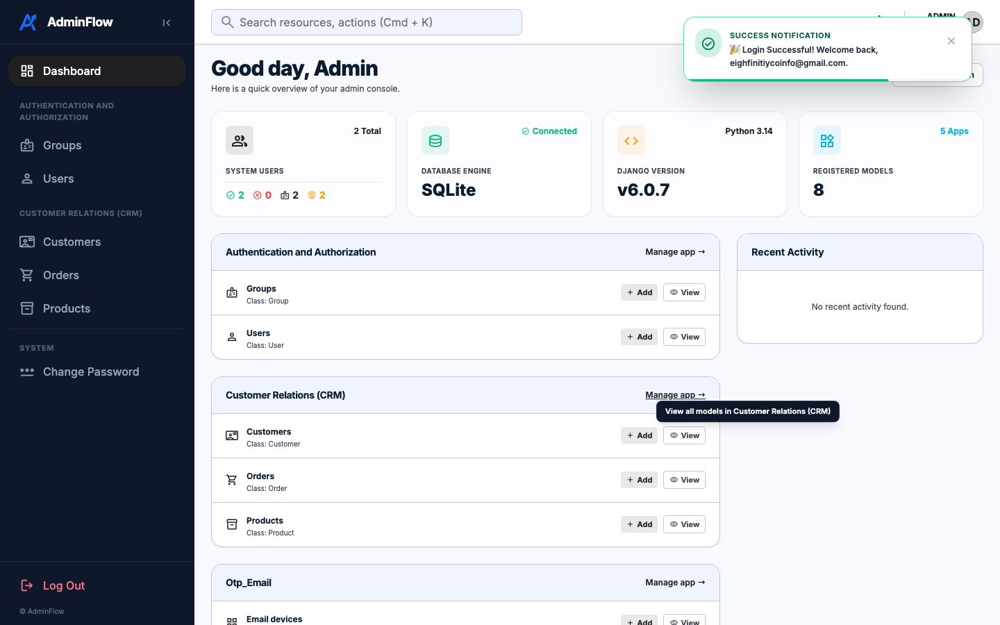

django-adminflow
================

**A modern Django Admin UI template with built-in integrations for popular 3rd party packages.**

.. image:: https://img.shields.io/pypi/v/django-adminflow.svg
   :target: https://pypi.org/project/django-adminflow/
   :alt: PyPI version

.. image:: https://img.shields.io/pypi/pyversions/django-adminflow.svg
   :target: https://pypi.org/project/django-adminflow/
   :alt: Python versions

.. image:: https://img.shields.io/pypi/djversions/django-adminflow.svg
   :target: https://pypi.org/project/django-adminflow/
   :alt: Django versions

.. image:: https://img.shields.io/badge/License-MIT-blue.svg
   :target: https://github.com/edgar/django-adminflow/blob/main/LICENSE
   :alt: License: MIT

----

AdminFlow is a **drop-in Django Admin UI template** that replaces the default Django admin with a
clean, minimalist SaaS-grade interface. Beyond the UI refresh, it ships with
**ready-to-use integrations** for the most popular Django ecosystem packages —
two-factor authentication, per-record audit history, and multi-format import/export —
so you get powerful admin features with zero boilerplate.

.. admonition:: One package, instant upgrade

   Install it, add it to ``INSTALLED_APPS``, and your admin instantly looks and
   works like a premium SaaS product.

----

Contents
--------

.. toctree::
   :maxdepth: 2
   :caption: Getting Started

   installation
   quickstart

.. toctree::
   :maxdepth: 2
   :caption: Features

   ui-features
   two-factor-auth
   audit-history
   import-export

.. toctree::
   :maxdepth: 2
   :caption: Reference

   customization
   changelog

----

Features at a Glance
--------------------

.. list-table::
   :header-rows: 1
   :widths: 20 80

   * - Feature
     - Description
   * - 🎨 **Modern UI**
     - Minimalist SaaS design — sidebar navigation, clean typography, responsive layout
   * - 🔒 **Two-Factor Auth**
     - TOTP (Google/Authy), email OTP, backup codes — multi-device support via ``django-otp``
   * - 📜 **Audit History**
     - Per-record change history with field-level diffs via ``django-simple-history``
   * - 📤 **Import / Export**
     - Multi-sheet XLSX + nested JSON via ``django-import-export``
   * - 🔌 **Plug & Play**
     - Add to ``INSTALLED_APPS`` — no extra configuration needed for the core UI
   * - 🌐 **i18n Ready**
     - All UI strings use ````
