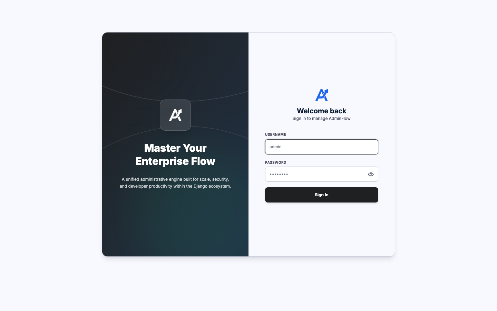
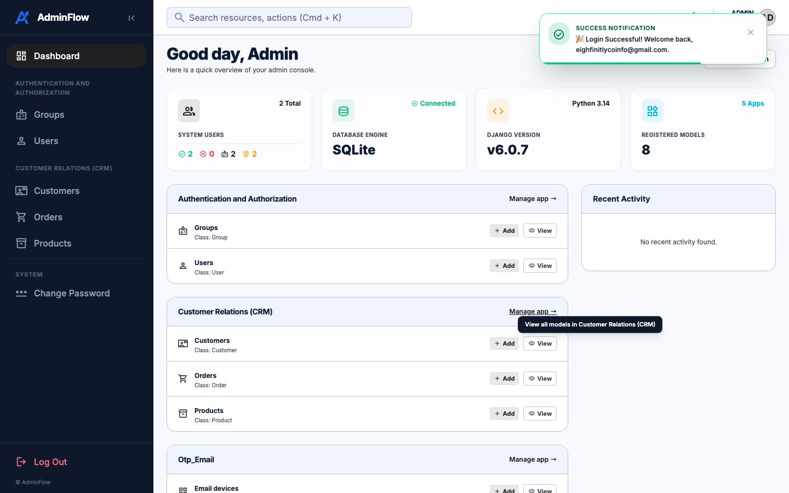

Quick Start
===========

This guide gets AdminFlow running in your project in under 5 minutes.

----

Step 1 — Install
----------------

.. code-block:: bash

   pip install "django-adminflow[all]"   # or pick individual extras

----

Step 2 — ``settings.py``
-------------------------

Here is the **complete** ``settings.py`` configuration with every AdminFlow setting documented.

INSTALLED_APPS
~~~~~~~~~~~~~~

Add ``"adminflow"`` **before** ``"django.contrib.admin"``.
Add the optional apps only for the integrations you installed.

.. code-block:: python

   INSTALLED_APPS = [
       "adminflow",                              # ← must be FIRST, before django.contrib.admin
       "django.contrib.admin",
       "django.contrib.auth",
       "django.contrib.contenttypes",
       "django.contrib.sessions",
       "django.contrib.messages",
       "django.contrib.staticfiles",

       # Your own apps
       "myapp",

       # ── Optional: add only what you installed ──────────────────────────────
       "simple_history",                         # audit history
       "import_export",                          # import / export
       "django_otp",                             # 2FA core
       "django_otp.plugins.otp_totp",            # TOTP (Google Authenticator, Authy)
       "django_otp.plugins.otp_email",           # email one-time passwords
       "django_otp.plugins.otp_static",          # backup / recovery codes
   ]

MIDDLEWARE
~~~~~~~~~~

.. code-block:: python

   MIDDLEWARE = [
       "django.middleware.security.SecurityMiddleware",
       "django.contrib.sessions.middleware.SessionMiddleware",
       "django.middleware.common.CommonMiddleware",
       "django.middleware.csrf.CsrfViewMiddleware",
       "django.contrib.auth.middleware.AuthenticationMiddleware",
       "django_otp.middleware.OTPMiddleware",                      # ← 2FA (after AuthenticationMiddleware)
       "django.contrib.messages.middleware.MessageMiddleware",
       "django.middleware.clickjacking.XFrameOptionsMiddleware",
       "simple_history.middleware.HistoryRequestMiddleware",        # ← history (records who made the change)
   ]

.. note::

   ``OTPMiddleware`` must come **after** ``AuthenticationMiddleware``.
   ``HistoryRequestMiddleware`` must come **after** ``AuthenticationMiddleware``.

TEMPLATES
~~~~~~~~~

Add AdminFlow's context processor so templates can access settings like the title and theme:

.. code-block:: python

   TEMPLATES = [
       {
           "BACKEND": "django.template.backends.django.DjangoTemplates",
           "DIRS": [],
           "APP_DIRS": True,
           "OPTIONS": {
               "context_processors": [
                   "django.template.context_processors.request",
                   "django.contrib.auth.context_processors.auth",
                   "django.contrib.messages.context_processors.messages",
                   "adminflow.context_processors.adminflow_settings",  # ← required
               ],
           },
       },
   ]

.. warning::

   ``adminflow.context_processors.adminflow_settings`` is **required**.
   Without it the sidebar title, theme colours and login panel text will not render.

AdminFlow Core Settings
~~~~~~~~~~~~~~~~~~~~~~~

.. code-block:: python

   # ── Branding ──────────────────────────────────────────────────────────────
   ADMINFLOW_TITLE   = "My App"          # sidebar header + browser tab title
   ADMINFLOW_COMPANY = "My Company"      # shown in the footer
   # ADMINFLOW_LOGO  = "logo.svg"        # path relative to MEDIA_URL

   # ── Theme colours ─────────────────────────────────────────────────────────
   ADMINFLOW_PRIMARY_COLOR             = "#1f2021"
   ADMINFLOW_SECONDARY_COLOR           = "#475569"
   ADMINFLOW_SUCCESS_COLOR             = "#10B981"
   ADMINFLOW_WARNING_COLOR             = "#F59E0B"
   ADMINFLOW_DANGER_COLOR              = "#EF4444"

   # ── Sidebar ────────────────────────────────────────────────────────────────
   ADMINFLOW_SIDEBAR_COLOR             = "#0f172a"   # sidebar background
   ADMINFLOW_SIDEBAR_TEXT_COLOR        = "#94a3b8"   # inactive item text
   ADMINFLOW_SIDEBAR_ACTIVE_TEXT_COLOR = "#ffffff"   # active item text
   ADMINFLOW_SIDEBAR_COLLAPSIBLE       = True        # allow sidebar to collapse
   ADMINFLOW_SIDEBAR_WIDTH             = 280         # width in pixels

   # ── UI ─────────────────────────────────────────────────────────────────────
   ADMINFLOW_BORDER_RADIUS             = "16px"      # card / input corner radius
   ADMINFLOW_FONT                      = "Inter"     # Google Font name
   ADMINFLOW_ENABLE_COMMAND_PALETTE    = True        # Cmd+K quick search

   # ── Login page hero banner ─────────────────────────────────────────────────
   ADMINFLOW_LOGIN_TITLE    = "Welcome back"
   ADMINFLOW_LOGIN_SUBTITLE = "Sign in to manage your application."

   # ── 2FA ───────────────────────────────────────────────────────────────────
   ADMINFLOW_DJANGO_OTP = True    # show OTP verification screen after login

Email (for Email OTP)
~~~~~~~~~~~~~~~~~~~~~

Required when using ``django_otp.plugins.otp_email``:

.. code-block:: python

   EMAIL_BACKEND       = "django.core.mail.backends.smtp.EmailBackend"
   EMAIL_HOST          = "smtp.gmail.com"
   EMAIL_PORT          = 587
   EMAIL_USE_TLS       = True
   EMAIL_HOST_USER     = "noreply@myapp.com"
   EMAIL_HOST_PASSWORD = "your-smtp-password"
   DEFAULT_FROM_EMAIL  = EMAIL_HOST_USER

   # django-otp email sender overrides
   OTP_EMAIL_SENDER            = EMAIL_HOST_USER
   OTP_EMAIL_FROM_EMAIL        = EMAIL_HOST_USER
   OTP_EMAIL_COOLDOWN_DURATION = 60   # seconds between OTP requests

.. tip::

   Store ``EMAIL_HOST_PASSWORD`` in an ``.env`` file and load it with
   ``python-dotenv`` or ``django-environ`` — never commit credentials to source control.

----

Full Example ``settings.py``
-----------------------------

.. code-block:: python

   from pathlib import Path
   import os

   BASE_DIR = Path(__file__).resolve().parent.parent

   SECRET_KEY = "your-secret-key"
   DEBUG      = True
   ALLOWED_HOSTS = []

   INSTALLED_APPS = [
       "adminflow",
       "django.contrib.admin",
       "django.contrib.auth",
       "django.contrib.contenttypes",
       "django.contrib.sessions",
       "django.contrib.messages",
       "django.contrib.staticfiles",
       # your apps
       "myapp",
       # optional integrations
       "simple_history",
       "import_export",
       "django_otp",
       "django_otp.plugins.otp_totp",
       "django_otp.plugins.otp_email",
       "django_otp.plugins.otp_static",
   ]

   MIDDLEWARE = [
       "django.middleware.security.SecurityMiddleware",
       "django.contrib.sessions.middleware.SessionMiddleware",
       "django.middleware.common.CommonMiddleware",
       "django.middleware.csrf.CsrfViewMiddleware",
       "django.contrib.auth.middleware.AuthenticationMiddleware",
       "django_otp.middleware.OTPMiddleware",
       "django.contrib.messages.middleware.MessageMiddleware",
       "django.middleware.clickjacking.XFrameOptionsMiddleware",
       "simple_history.middleware.HistoryRequestMiddleware",
   ]

   ROOT_URLCONF = "myproject.urls"

   TEMPLATES = [
       {
           "BACKEND": "django.template.backends.django.DjangoTemplates",
           "DIRS": [],
           "APP_DIRS": True,
           "OPTIONS": {
               "context_processors": [
                   "django.template.context_processors.request",
                   "django.contrib.auth.context_processors.auth",
                   "django.contrib.messages.context_processors.messages",
                   "adminflow.context_processors.adminflow_settings",  # ← required
               ],
           },
       },
   ]

   DATABASES = {
       "default": {
           "ENGINE": "django.db.backends.sqlite3",
           "NAME": BASE_DIR / "db.sqlite3",
       }
   }

   STATIC_URL  = "static/"
   MEDIA_URL   = "/media/"
   MEDIA_ROOT  = BASE_DIR / "media"

   # ── AdminFlow ──────────────────────────────────────────────────────────────
   ADMINFLOW_TITLE                     = "My App"
   ADMINFLOW_COMPANY                   = "My Company"
   ADMINFLOW_PRIMARY_COLOR             = "#1f2021"
   ADMINFLOW_SECONDARY_COLOR           = "#475569"
   ADMINFLOW_SUCCESS_COLOR             = "#10B981"
   ADMINFLOW_WARNING_COLOR             = "#F59E0B"
   ADMINFLOW_DANGER_COLOR              = "#EF4444"
   ADMINFLOW_SIDEBAR_COLOR             = "#0f172a"
   ADMINFLOW_SIDEBAR_TEXT_COLOR        = "#94a3b8"
   ADMINFLOW_SIDEBAR_ACTIVE_TEXT_COLOR = "#ffffff"
   ADMINFLOW_SIDEBAR_COLLAPSIBLE       = True
   ADMINFLOW_SIDEBAR_WIDTH             = 280
   ADMINFLOW_BORDER_RADIUS             = "16px"
   ADMINFLOW_FONT                      = "Inter"
   ADMINFLOW_ENABLE_COMMAND_PALETTE    = True
   ADMINFLOW_LOGIN_TITLE               = "Welcome back"
   ADMINFLOW_LOGIN_SUBTITLE            = "Sign in to manage your application."
   ADMINFLOW_DJANGO_OTP                = True

   # ── Email OTP ──────────────────────────────────────────────────────────────
   EMAIL_BACKEND               = "django.core.mail.backends.smtp.EmailBackend"
   EMAIL_HOST                  = os.getenv("EMAIL_HOST", "smtp.gmail.com")
   EMAIL_PORT                  = int(os.getenv("EMAIL_PORT", 587))
   EMAIL_USE_TLS               = True
   EMAIL_HOST_USER             = os.getenv("EMAIL_HOST_USER", "")
   EMAIL_HOST_PASSWORD         = os.getenv("EMAIL_HOST_PASSWORD", "")
   DEFAULT_FROM_EMAIL          = EMAIL_HOST_USER
   OTP_EMAIL_SENDER            = EMAIL_HOST_USER
   OTP_EMAIL_FROM_EMAIL        = EMAIL_HOST_USER
   OTP_EMAIL_COOLDOWN_DURATION = 60

----

Step 3 — Run migrations
-----------------------

.. code-block:: bash

   python manage.py migrate

----

Step 4 — Collect static files
------------------------------

.. code-block:: bash

   python manage.py collectstatic

----

Step 5 — Visit your admin
--------------------------

Start your dev server and open http://localhost:8000/admin/.

After login you will see the new dashboard:

----

Next Steps
----------

* :doc:`two-factor-auth` — enable 2FA for your staff users
* :doc:`audit-history` — track every change with field-level diffs
* :doc:`import-export` — export all related data in one file
* :doc:`ui-features` — learn about the sidebar, icons, and more
* :doc:`customization` — full settings reference
