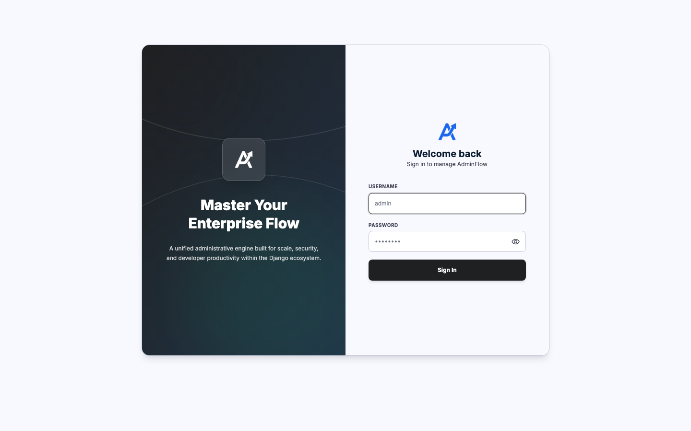
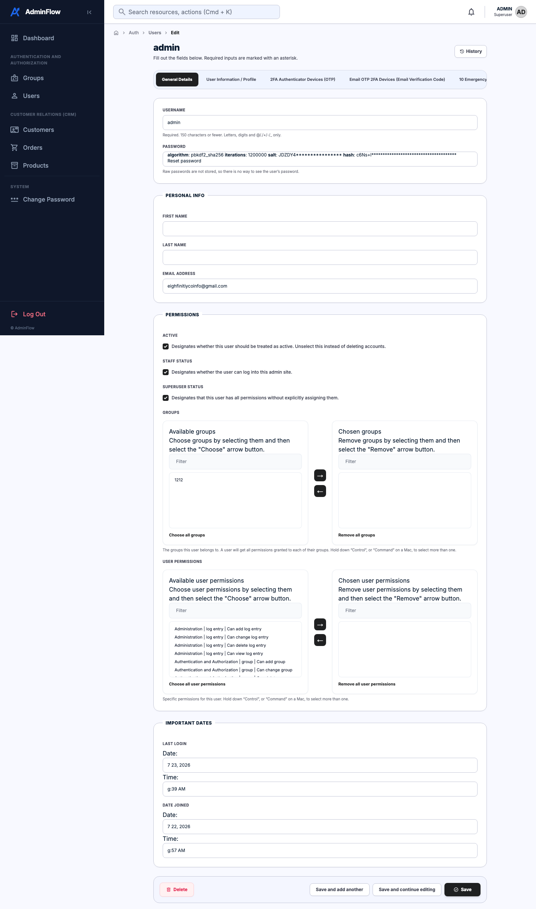

Two-Factor Authentication
=========================

AdminFlow wraps `django-otp <https://django-otp-official.readthedocs.io/>`_ with a polished
UI: a styled OTP verification page on login, per-device management inside the user admin,
and bulk admin actions for enabling 2FA across your team.

----

Requirements
------------

.. code-block:: bash

   pip install "django-adminflow[otp]"

Add to ``INSTALLED_APPS``:

.. code-block:: python

   INSTALLED_APPS = [
       "adminflow",
       "django.contrib.admin",
       ...
       "django_otp",
       "django_otp.plugins.otp_totp",    # TOTP — Google Authenticator, Authy, etc.
       "django_otp.plugins.otp_email",   # email one-time passwords
       "django_otp.plugins.otp_static",  # backup codes
   ]

Add the OTP middleware **after** ``AuthenticationMiddleware``:

.. code-block:: python

   MIDDLEWARE = [
       ...
       "django.contrib.auth.middleware.AuthenticationMiddleware",
       "django_otp.middleware.OTPMiddleware",   # ← add this
       ...
   ]

Add to ``urls.py``:

.. code-block:: python

   # urls.py
   from django.contrib import admin
   from django.urls import path
   from adminflow.views import adminflow_verify_2fa_view

   urlpatterns = [
       path('admin/verify-2fa/', adminflow_verify_2fa_view, name='adminflow_verify_2fa'),
       path('admin/', admin.site.urls),
   ]

.. note::

   The 2FA verification route must be placed **before** ``admin.site.urls``.

Run migrations:

.. code-block:: bash

   python manage.py migrate

----

Setting Up the User Admin
--------------------------

Replace the default ``UserAdmin`` with AdminFlow's version to get the 2FA management UI:

.. code-block:: python

   # admin.py
   from django.contrib import admin
   from django.contrib.auth import get_user_model
   from django.contrib.auth.admin import UserAdmin as BaseUserAdmin
   from adminflow.user_admin import (
       AdminFlowUserAdminMixin,
       get_2fa_inlines,
       unregister_otp_models,
   )

   User = get_user_model()

   @admin.register(User)
   class UserAdmin(AdminFlowUserAdminMixin, BaseUserAdmin):
       inlines = get_2fa_inlines()

   # Remove the raw django-otp device admin entries
   unregister_otp_models()

----

How It Works
------------

Login Flow
~~~~~~~~~~

1. User enters username + password on the login page
2. If they have a confirmed OTP device → AdminFlow shows the OTP verification screen
3. User enters the 6-digit code from their authenticator app (or email, or backup code)
4. On success → redirected to the admin dashboard

User 2FA Management
~~~~~~~~~~~~~~~~~~~

In the user change form, staff users see a **Security** section with their registered devices:

**Supported device types:**

.. list-table::
   :header-rows: 1
   :widths: 30 70

   * - Device Type
     - Description
   * - **TOTP** (``otp_totp``)
     - Time-based 6-digit codes. Works with Google Authenticator, Authy, 1Password, etc.
   * - **Email OTP** (``otp_email``)
     - One-time codes sent to the user's email address
   * - **Backup Codes** (``otp_static``)
     - Single-use 8-character codes for account recovery

----

Admin Bulk Actions
------------------

Select users in the user list and use the **Actions** dropdown:

* **Enable 2FA for selected users** — creates email OTP devices for selected users
* **Generate 10 backup codes** — creates static backup codes for selected users

----

Email OTP Settings
------------------

If using email OTP, configure your email backend in ``settings.py``:

.. code-block:: python

   EMAIL_BACKEND   = "django.core.mail.backends.smtp.EmailBackend"
   EMAIL_HOST      = "smtp.example.com"
   EMAIL_PORT      = 587
   EMAIL_USE_TLS   = True
   EMAIL_HOST_USER = "noreply@example.com"
   EMAIL_HOST_PASSWORD = "your-smtp-password"

----

Disabling 2FA Requirement
--------------------------

To allow staff to log in without 2FA (e.g., during development):

.. code-block:: python

   # settings.py
   OTP_ADMIN_HIDE_SENSITIVE_DATA = False   # default — 2FA is optional not enforced

To **enforce** 2FA for all admin logins, override ``has_permission`` in your admin site.
