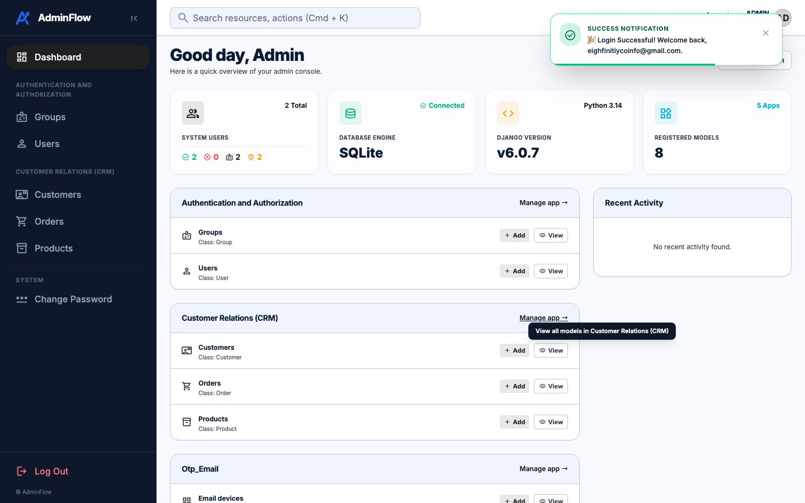
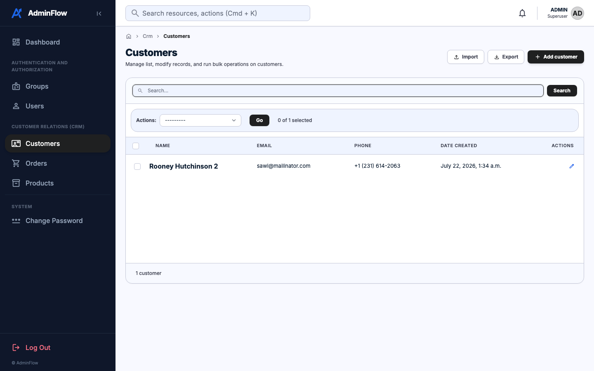
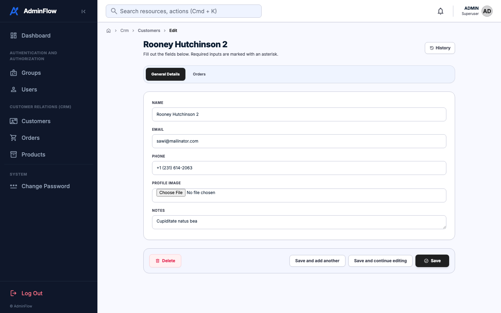
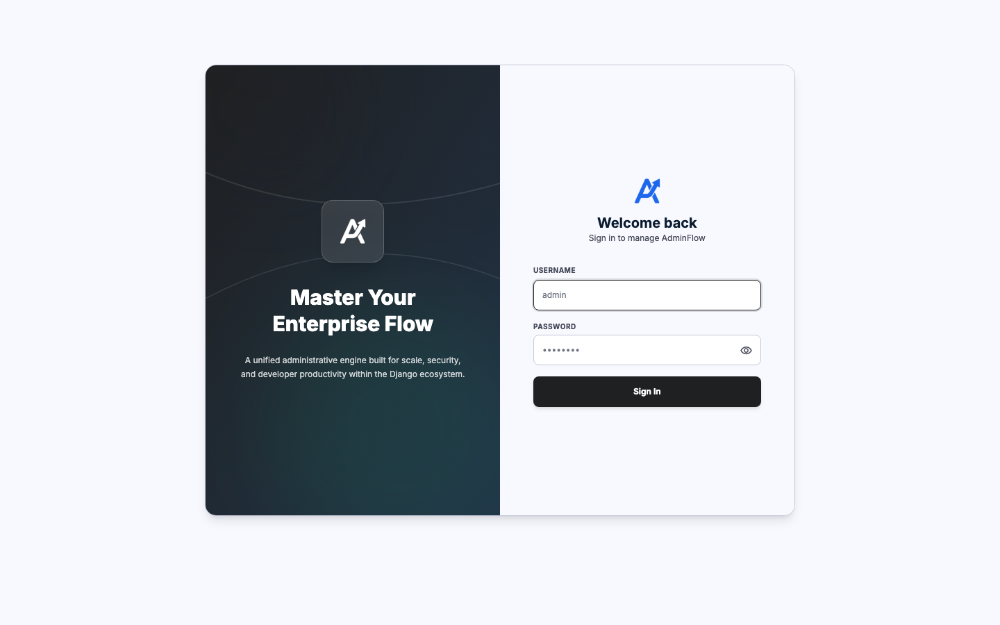

UI Features
===========

AdminFlow replaces every default Django admin template with a polished, minimalist UI.
No extra configuration is needed — just having ``"adminflow"`` in ``INSTALLED_APPS`` is enough.

----

Dashboard
---------

The dashboard shows system stats (registered models, Django version, database engine,
active users) and a quick-access grid for every registered model.

**Features:**

* System stats cards — DB engine, Django version, Python version, registered model count
* Per-app model grid with **Add** and **View** shortcuts
* Recent Activity sidebar
* Success / error / warning toast notifications on login and actions

----

Sidebar Navigation
------------------

The left sidebar groups models by Django app with:

* Collapsible app sections
* Per-model icons (configurable via ``icon`` attribute)
* Active state tracking — highlights the current page
* **Log Out** link pinned to the bottom

**Setting a custom icon per model:**

.. code-block:: python

   from django.contrib import admin
   from .models import Product

   @admin.register(Product)
   class ProductAdmin(admin.ModelAdmin):
       icon = "inventory_2"   # any Material Symbols icon name

Icon names come from `Google Material Symbols <https://fonts.google.com/icons>`_.

----

Model List (Changelist)
-----------------------

The changelist includes:

* Search bar and filter button in a clean toolbar
* **Import** and **Export** action buttons (when ``django-import-export`` is installed)
* Sortable column headers
* Inline action icons per row (edit, view, delete)
* Pagination with page size control

----

Model Change Form
-----------------

The change form features:

* Grouped fieldsets with collapsible sections
* Inline related models rendered as stacked or tabular inlines
* **History** button — links to the audit trail (when ``django-simple-history`` is installed)
* Save / Save and continue / Save and add another buttons in a sticky footer bar

----

Login Page
----------

The login page is a centered card with the ``ADMINFLOW_TITLE`` displayed at the top.

----

Customisation Settings
----------------------

.. list-table::
   :header-rows: 1
   :widths: 30 20 50

   * - Setting
     - Default
     - Description
   * - ``ADMINFLOW_TITLE``
     - ``"AdminFlow"``
     - Text shown in the sidebar header and browser tab
